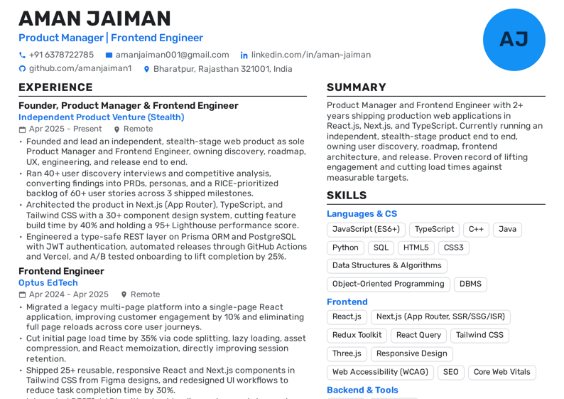
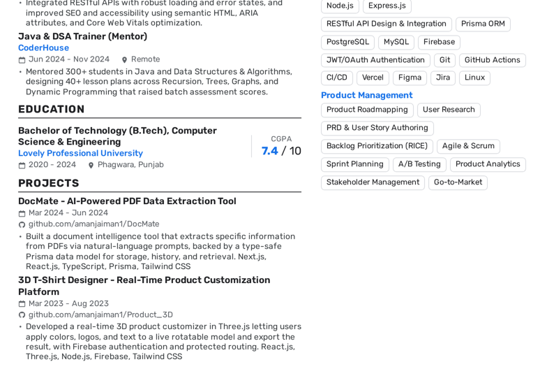
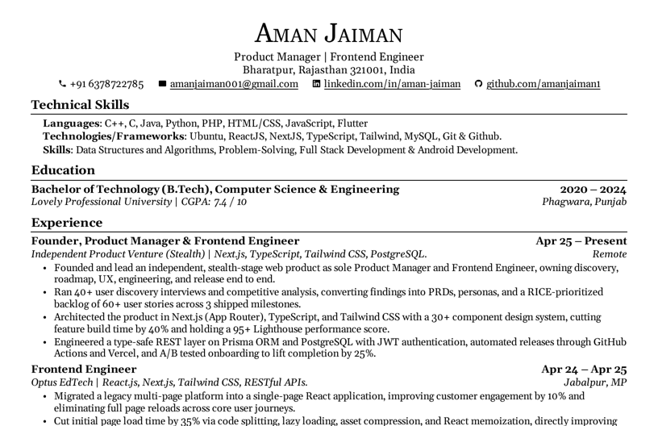
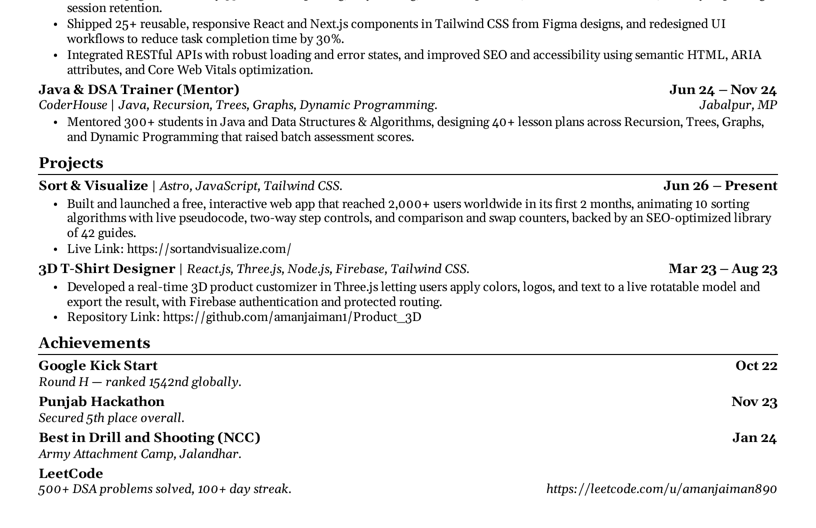
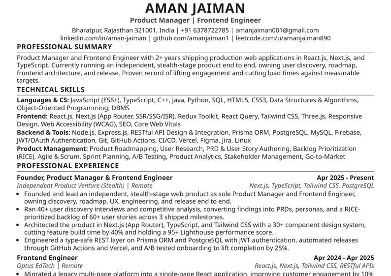
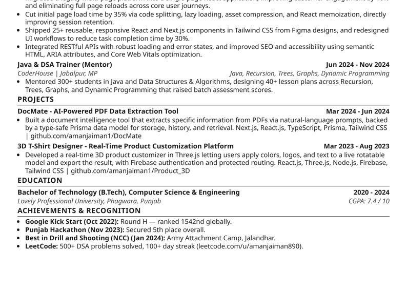

# Aman Jaiman — Resume

ATS-optimized resume for **Aman Jaiman** (Product Manager & Frontend Engineer), maintained as code so all
formats stay in sync from a single source of truth.

## Which file do I send?

| File | Look | When to use |
|---|---|---|
| [`Aman_Jaiman_Resume_Template.pdf`](Aman_Jaiman_Resume_Template.pdf) | Two-column, styled, Rubik font | A **human** reads it — email, portfolio, LinkedIn, recruiter direct |
| [`Aman_Jaiman_Resume_Classic.pdf`](Aman_Jaiman_Resume_Classic.pdf) | Single column, serif (Gelasio), US Letter: the layout of the original resume | Anywhere the original resume was used. Template content, with the original Technical Skills |
| [`Aman_Jaiman_Resume.pdf`](Aman_Jaiman_Resume.pdf) / [`.docx`](Aman_Jaiman_Resume.docx) | Single column, plain | A **machine** parses it — application portals / ATS (Workday, Taleo, Greenhouse, Lever) |
| [`Aman_Jaiman_Resume.md`](Aman_Jaiman_Resume.md) | Plain text | Pasting into application text boxes / LinkedIn |

If a portal only accepts one file and you can't tell what it runs, upload the plain one — a resume that parses
correctly beats a pretty one that doesn't. Full rationale in [`NOTES.md`](NOTES.md).

## Previews

**Styled template**




**Classic (original layout)**




**Plain (ATS)**




## Editing & regenerating

All formats read from [`content.py`](content.py). Edit it once, then rebuild everything:

```bash
pip install python-docx playwright pypdf pillow fonttools
python -m playwright install chromium

python build.py                # plain: .docx + .html + .md
python render_pdf.py           # plain: .pdf   (asserts single page)
python build_template.py       # styled: .html
python render_template_pdf.py  # styled: .pdf  (asserts single page + prints parser extraction)
python build_classic.py        # classic: .html
python render_classic_pdf.py   # classic: .pdf (asserts one US Letter page + checks parser extraction)

python ats_check.py            # 33-point ATS parse audit of the plain .docx
```

## Repo layout

```
content.py               Single source of truth (all resume text)
build.py                 Plain single-column -> .docx / .html / .md
render_pdf.py            Plain -> .pdf, asserts it fits one page
build_template.py        Styled two-column -> .html (Rubik, avatar, pills)
render_template_pdf.py   Styled -> .pdf, asserts one page + shows what an ATS extracts
build_classic.py         Classic single-column, the original resume's layout -> .html
render_classic_pdf.py    Classic -> .pdf, asserts one US Letter page + checks what a parser extracts
ats_check.py             Parser-simulation audit harness
fonts/                   Rubik and Gelasio (OFL) fonts, embedded into the styled and classic PDFs
NOTES.md                 What to verify before sending, and the ATS tradeoff explained
```

> **Before sending:** some metrics (the stealth-venture figures, and a few at Optus/CoderHouse) are
> illustrative placeholders. Replace them with real numbers first — see [`NOTES.md`](NOTES.md).
